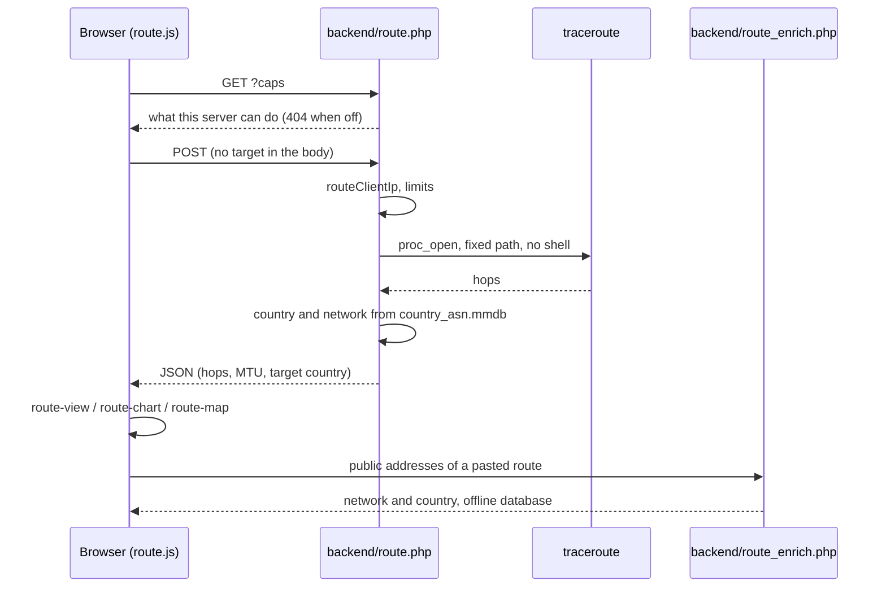

# Architecture

How this fork is put together. For what each part does for the visitor see the [README](README.md); for running the route page see
[docs/route.md](docs/route.md); for the risks see [SECURITY.md](SECURITY.md). The speed test engine and its protocol are the
upstream ones and are described in [doc.md](doc.md).

## The idea in four lines

- No build step: the pages are plain HTML, classic scripts and CSS, served as they are. There is no bundler and no framework.
- Nothing is loaded from a third party: fonts, the chart library and the map data are in the repository.
- Everything new is optional: the better pages sit beside the upstream pages, and the route and the telemetry are off until the
  operator turns them on.
- Almost all the state of a visitor stays in the visitor's browser.

## Layout of the repository

| Path | What is in it |
| ---- | ------------- |
| `speedtest.js`, `speedtest_worker.js`, `stability_worker.js` | the test engine (upstream) and the worker of the stability test |
| `index.html`, `index-classic.html`, `index-modern.html`, `design-switch.js`, `config.json` | the upstream pages and the switcher between them ([DESIGN_SWITCH.md](DESIGN_SWITCH.md)) |
| `index-better.html`, `stability-better.html`, `route-better.html` | the three better pages; reached by their own address, not by the switcher |
| `better-defaults.js`, `settings.json`, `server-list.json` | site defaults of the better pages, worker settings, the list of test points |
| `frontend/` | assets of the modern page (upstream) |
| `frontend/better/` | everything of the better pages: `javascript/`, `styling/`, `locales/`, `fonts/`, `vendor/`, `icons/`, `backgrounds/`, `map/` (see its [README](frontend/better/README.md)) |
| `backend/` | PHP of the test point: `garbage.php`, `empty.php`, `getIP.php`; and of the route: `route.php`, `route_enrich.php`, `route_util.php`, `route_settings.php`, with `country_asn.mmdb` |
| `results/` | telemetry, stats and shared results (upstream, with a redesigned stats page) |
| `docker/`, `Dockerfile`, `Dockerfile.alpine` | the images: `entrypoint.sh` (configuration from environment variables), Apache and PHP settings, headers |
| `tests/` | Playwright specs (`e2e/`), PHP tests, fixtures of route outputs |
| `images/`, `manifest.webmanifest` | icons and web app manifest of the better pages |

## The three better pages

All three share the same modules from `frontend/better/javascript/`:

- `i18n.js` and `locales/{en,pt,es,sv}.json`: flat catalogs with dotted keys, read through `data-i18n` attributes and
  `LibreSpeedI18n.t`. English text in the HTML is the fallback for a missing key.
- `theme.js`, `theme-panel.js`, `colors.js`, `font.js`, `background.js`, `accessibility.js`, `icons.js` and `styling/tokens.css`: the options
  panel (colour, mode, rounding, fonts, icon set, background, text size, high contrast). Choices are kept in `localStorage`; a URL
  parameter wins.
- `test-history.js`, `history-periods.js`, `toast.js`: a generic history (list, pages, periods, medians with a trend, CSV) that each
  page configures with its own columns.
- `consent.js`, `sponsor.js`: the privacy notice and the optional sponsor line.

`index-better.html` (`index.js`, `meter.js`) is the speed test, `stability-better.html` (`stability.js`, `stability-tools.js`, charts
by `chart-uplot.js` and `chart-styles.js`) the stability test, and `route-better.html` the route page.

## Speed test flow

The page drives `speedtest.js`, which starts `speedtest_worker.js` in a Web Worker. The worker calls `backend/getIP.php`, `empty.php`
(ping and upload) and `garbage.php` (download) of the chosen test point (one entry of `server-list.json`). If telemetry is on, the
page sends the result to `results/telemetry.php`, which writes it to the database, and the result gets a shareable id.

## Route flow

- **From the server** (`route.php`): the target is the client address (`routeClientIp` in `route_util.php`), never a request value. The
  hops are enriched from `country_asn.mmdb`. `route_util.php` holds the testable functions (the PHP tests load it directly).
- **The views** (`route-view.js` prepares the data, `route-chart.js` draws with uPlot, `route-map.js` draws countries as SVG from
  `vendor/world-110m.js`, which `map/build-world.js` makes from Natural Earth). `route-crossings.js` adds sea crossings between
  country pairs, only when the time rises as much as light in fibre needs.
- **The way back** (`route-back.js`, `route-parse.js`): the visitor pastes the output of their system's route tool, or gets it from
  [`librespeed-route`](https://github.com/HyakoV3/librespeed-route) (command line) and its browser extension (Native Messaging). The
  page parses the text in the browser. `route-parse.js` has a twin in `route_util.php` and `tests/route_parity.php` keeps the two
  equal on the sample outputs in `tests/fixtures/route-back/`. A one-line format (LSR1) is what the program writes; its protocol is
  in that repository. `route-side.js` is the side panel that holds it all.
- **History** (`route-history.js`): the routes are kept in the browser (see below).

## What is stored, and where

| Where | What | Notes |
| ----- | ---- | ----- |
| Browser `localStorage` | `librespeed-better-history` (speed tests, with IP), `-history-summary` (2000 rows, no IP), `-stability-history`, `-stability-history-summary`, `-route-history`, `-route-history-summary`, and the options and small settings (for example `-language`, `-font`, `-bg`, `-icons`, `-route-view`, `-route-direction`, `-route-side`; all names start with `librespeed-better-`) | never sent to the server |
| Server database | one row per test, only when telemetry is on | SQLite by default in Docker (`/database`), or MySQL, PostgreSQL, MSSQL |
| Server temp dir | keyed hashes and request times of the route limits | `/tmp/librespeed-route`; see [docs/route.md](docs/route.md) |

## Docker

`docker/entrypoint.sh` rebuilds the web root on every start from `/speedtest`, from the environment variables
([doc_docker.md](doc_docker.md)):

- `MODE`: `standalone` (UI and test point), `backend` (test point only), `frontend` (UI, with a server list), `dual` (both).
- `TELEMETRY=true` copies `results/` and writes the settings (including the stats `PASSWORD`).
- `ENABLE_ROUTE=true` (standalone and dual) writes `backend/route_settings.php` and shows the link on the pages.
- `TITLE` and `TAGLINE` are written into the pages.
- `docker/librespeed-headers.conf` and `docker/librespeed-php.ini` hold the cache lifetimes, two security headers and the PHP limits.

The image is built for Debian (`Dockerfile`) and Alpine (`Dockerfile.alpine`); the Alpine one uses its own `traceroute` package.

## Tests

`npm run test:e2e` runs the Playwright specs in `tests/e2e/`. They build the image and start a container (`tests/docker-compose-playwright.yml`), so Docker is required. The PHP tests in `tests/*.php` are run by hand. See [CONTRIBUTING.md](CONTRIBUTING.md).

## Why some things are the way they are

- **No build step**: the code can be read, edited and served as it is, and a deployment is a copy of files.
- **Route by country pair, not by cable**: the names of cables do not follow a rule that can be detected; the crossing is drawn
  between two coasts and said to be approximate.
- **The route target is the visitor, only**: the feature runs a program on the server, so the only input it accepts is the address
  of the connection.
- **Everything of the way back is parsed in the browser**: the server never receives the pasted text, only the public addresses to
  look up.
- **Strings in four languages** (en, pt, es, sv): a string that is only in English is a bug.
