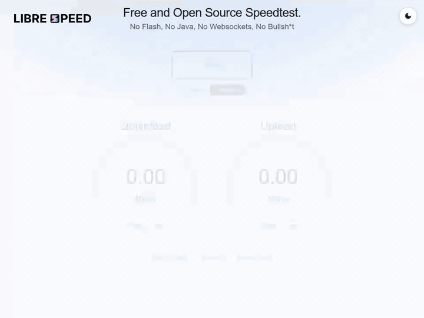
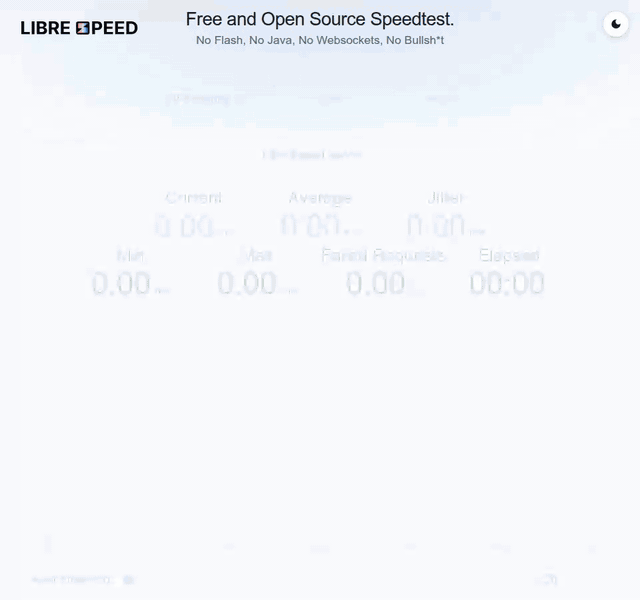
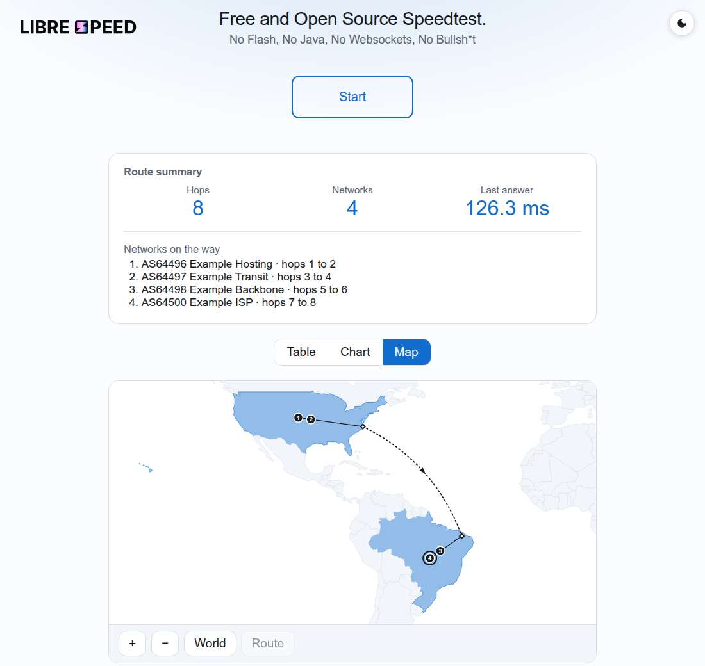

# LibreSpeed, better pages

A fork of [LibreSpeed](https://github.com/librespeed/speedtest), the free and open source speed test, with three new pages
(**better** pages: speed test, stability test and a route page), a history of your results, four languages, and a way to see the path
between your device and the server. It keeps everything of upstream: the classic and modern pages, the test engine and the backends
still work as before, and everything new is optional.

No Flash, No Java, No Websocket, No Bullshit.

## What this fork adds

| Page | What it does |
| ---- | ------------ |
| `index-better.html` | The speed test (download, upload, ping, jitter, IP and ISP), with a history of results by period, a share image and the options panel |
| `stability-better.html` | A connection stability test: latency chart, loss, threshold alerts, history and CSV export; targets are this server, the configured test points, or Google, Cloudflare and Apple |
| `route-better.html` | The route from the server to you (routers, time, network, approximate country, path MTU) as a table, a chart or a map, plus the way back that you trace on your own device. **Off by default** |

| Speed test | Stability test |
| :--------: | :------------: |
|  |  |



*The animations were recorded on a local test server with a limited, simulated connection, and the route is an example made of
documentation addresses (`192.0.2.0/24`, `198.51.100.0/24`, `203.0.113.0/24`), not a real network.*

Common to the three: English, Portuguese, Spanish and Swedish; light, dark and high-contrast modes, colours, fonts, icon sets and
backgrounds that you pick in a panel; text size; and no request to a third party when the page loads, because the fonts, the chart
library and the map data are served by your own server. The options and URL parameters are in [frontend/better/README.md](frontend/better/README.md). The better
pages are reached by their own address (for example `/index-better.html`), not by the `?design=` switch of the other pages.

## Quick start

With Docker, from the source of this repository:

```shell
docker build -t librespeed-better .
docker run --rm -p 80:8080 librespeed-better
```

Then open `http://localhost/index-better.html`. The image is also published as `ghcr.io/hyakov3/speedtest` (the upstream image, `ghcr.io/librespeed/speedtest`, does not have the
better pages); whether you can pull it depends on the visibility of the package. The route page is off in the image. Turning it on
(`-e ENABLE_ROUTE=true`) lets visitors make your server run `traceroute` towards their own address; read
[docs/route.md](docs/route.md) and [SECURITY.md](SECURITY.md) first. The other variables are in [doc_docker.md](doc_docker.md).

Without Docker, follow Installation below: the better pages are in the same folder as the other pages, so copying the repository
layout as it is already installs them (the route page also needs `backend/route_settings.php` edited, see [docs/route.md](docs/route.md)).

## Privacy at a glance

- **In your browser** (`localStorage`, never sent anywhere): the history of speed tests (with your IP address), a summary of results
  (no address), the history of stability tests, the history of routes (with the addresses of the routers) and your choices in the
  options panel.
- **On the server**: nothing about you unless the operator turns telemetry on (then each result is a row in their database), and, if the
  route page is on, a keyed hash of your address and the time of your requests, for the rate limits.
- **To third parties**: nothing by default. If the operator sets an ipinfo.io key, your address goes to ipinfo.io for the ISP lookup. If you pick Google, Cloudflare or Apple as the target of the stability test, your browser contacts that company directly.

Details, and what an operator should do about it, are in [SECURITY.md](SECURITY.md).

## Documentation

| File | For |
| ---- | --- |
| [docs/route.md](docs/route.md) | running the route page: proxies, IPv6, limits, what is kept |
| [doc_docker.md](doc_docker.md) | the Docker image and all its variables |
| [ARCHITECTURE.md](ARCHITECTURE.md) | how the repository and the pages are put together |
| [SECURITY.md](SECURITY.md) | how to report a problem, and what to protect |
| [CONTRIBUTING.md](CONTRIBUTING.md), [DEVELOPMENT.md](DEVELOPMENT.md) | working on the code, tests |
| [DESIGN_SWITCH.md](DESIGN_SWITCH.md) | the classic/modern switch |
| [doc.md](doc.md) | the speed test engine (upstream) |

The way back of the route page can use [`librespeed-route`](https://github.com/HyakoV3/librespeed-route), a small command line
program with a browser extension (separate repository, MIT OR Apache-2.0).

## Third-party material

Fonts (SIL Open Font License, with their licence files in `frontend/better/fonts/licenses/` except Inter), uPlot (MIT), country shapes
from [Natural Earth](https://www.naturalearthdata.com/) (public domain), the offline database of networks and countries from
[ipinfo.io](https://ipinfo.io) (CC BY-SA 4.0) and `geoip2.phar` from MaxMind (Apache-2.0). Where they come from is in the README
of each folder under `frontend/better/`.

---

# Upstream LibreSpeed

What follows is the README of LibreSpeed, kept as it was, except where it says it only applies to the classic page.

## Try it

[Take a speed test](https://librespeed.org)

## Compatibility

All modern browsers are supported by the classic page: IE11, latest Edge, latest Chrome, latest Firefox, latest Safari.
Works with mobile versions too. The better pages use newer browser features (for example `fetch`) and do not support old browsers.

## Features

* Download
* Upload
* Ping
* Jitter
* IP Address, ISP, distance from server (optional)
* Telemetry (optional)
* Results sharing (optional)
* Multiple Points of Test (optional)
* Connection stability test with latency charting, loss tracking, threshold alerts, and CSV export


## Server requirements

* A reasonably fast web server with Apache 2 (nginx, IIS also supported)
* PHP 5.4 or newer (other backends also available)
* MariaDB or MySQL database to store test results (optional, Microsoft SQL Server, PostgreSQL and SQLite also supported)
* A fast! internet connection

## Installation

Assuming you have PHP and a web server installed, the installation steps are quite simple.

1. Download the source code and extract it
1. Copy the project files to your web server's shared folder (ie. `/var/www/html/speedtest` for Apache), keeping the layout as it is in the repository. The modern UI loads its assets from `frontend/`, so that directory is copied as a whole rather than unpacked.
1. Optionally, copy the results folder too, and set up the database using the config file in it.
1. Be sure your permissions allow read and execute access where needed.
1. Visit YOURSITE/speedtest/index.html and voila!

### Installation Video

This video shows the installation process of a standalone LibreSpeed server: [Quick start installation guide for Debian 12](https://fdossena.com/?p=speedtest/quickstart_deb12.frag)

More videos will be added later.

## Android app

A template to build an Android client for your LibreSpeed installation is available [here](https://github.com/librespeed/speedtest-android).

## CLI client

A command line client is available [here](https://github.com/librespeed/speedtest-cli).

## .NET client

A .NET client library is available in the [`LibreSpeed.NET`](https://github.com/Memphizzz/LibreSpeed.NET) repo ([NuGet](https://www.nuget.org/packages/LibreSpeed.NET)), maintained by [MemphiZ](https://github.com/Memphizzz).

## Development

If you want to contribute or develop with LibreSpeed, see [DEVELOPMENT.md](DEVELOPMENT.md) for information about using npm for development tasks, linting, and formatting.

## Design switch

LibreSpeed supports both the classic and modern UI. The root `index.html` acts as a lightweight switcher and redirects to `index-classic.html` or `index-modern.html` based on `config.json` (`useNewDesign`) or URL overrides (`?design=new` / `?design=old`). For architecture and deployment details (including Docker behavior), see [DESIGN_SWITCH.md](DESIGN_SWITCH.md).

## Stability test

LibreSpeed includes a standalone connection stability test at `stability.html`, linked from both the classic and modern interfaces. It repeatedly measures ping over a selected duration and reports current, average, minimum, maximum, jitter, and failed request percentage values with a live chart.

The stability test can target the local LibreSpeed backend, one of the configured multiple points of test, or built-in external targets such as Google, Cloudflare, and Apple. It also supports optional latency threshold alerts and CSV export of the collected samples. Docker deployments copy `stability.html` and `stability_worker.js` into the web root and reuse the same server list configuration as the main UI.

## Docker

A docker image is available on [GitHub](https://github.com/librespeed/speedtest/pkgs/container/speedtest), check our [docker documentation](doc_docker.md) for more info about it.
The image is built every week to include an updated version of the ipinfo-DB used for ISP detection. Also this ensures, that the latest security patches in PHP are installed. Therefore we recommend to use the `latest` image.

## Go backend

A Go implementation is available in the [`speedtest-go`](https://github.com/librespeed/speedtest-go) repo, maintained by [Maddie Zhan](https://github.com/maddie).

## Rust backend

A Rust implementation is available in the [`speedtest-rust`](https://github.com/librespeed/speedtest-rust) repo, maintained by [Sudo Dios](https://github.com/sudodios).

## Node.js backend

A partial Node.js implementation is available in the `node` branch, developed by [dunklesToast](https://github.com/dunklesToast). It's not recommended to use at the moment.

## Donate

[](https://liberapay.com/fdossena/donate)
[Donate with PayPal](https://www.paypal.me/sineisochronic)

## License

Copyright (C) 2016-2024 Federico Dossena

This program is free software: you can redistribute it and/or modify
it under the terms of the GNU Lesser General Public License as published by
the Free Software Foundation, either version 3 of the License, or
(at your option) any later version.

This program is distributed in the hope that it will be useful,
but WITHOUT ANY WARRANTY; without even the implied warranty of
MERCHANTABILITY or FITNESS FOR A PARTICULAR PURPOSE.  See the
GNU General Public License for more details.

You should have received a copy of the GNU Lesser General Public License
along with this program.  If not, see <https://www.gnu.org/licenses/lgpl>.
